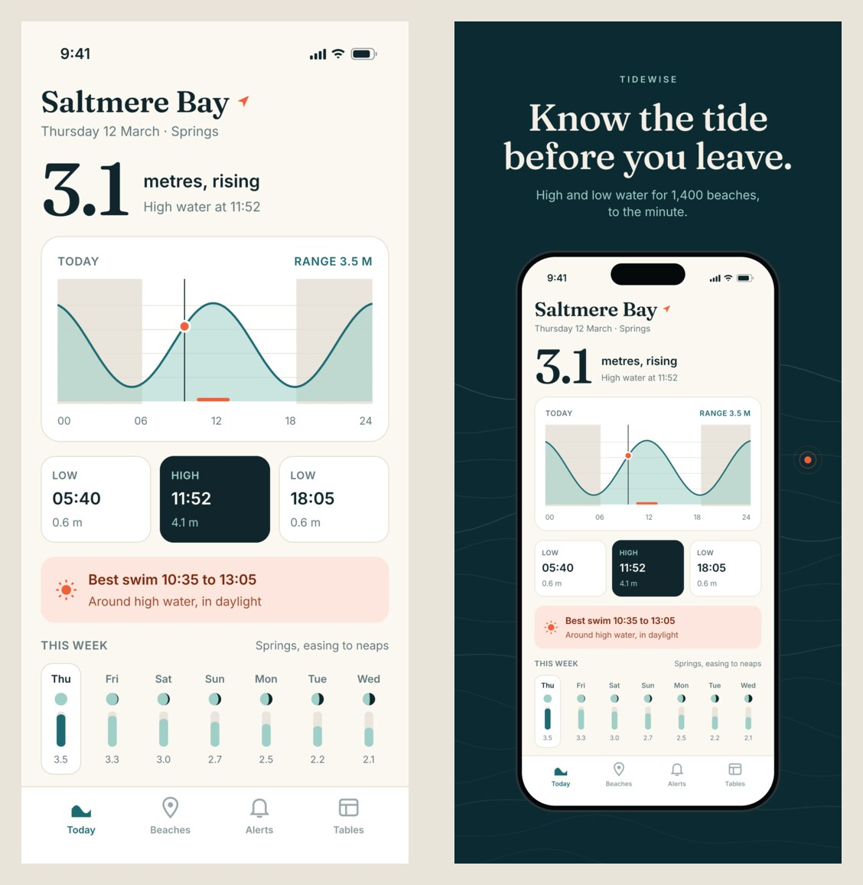
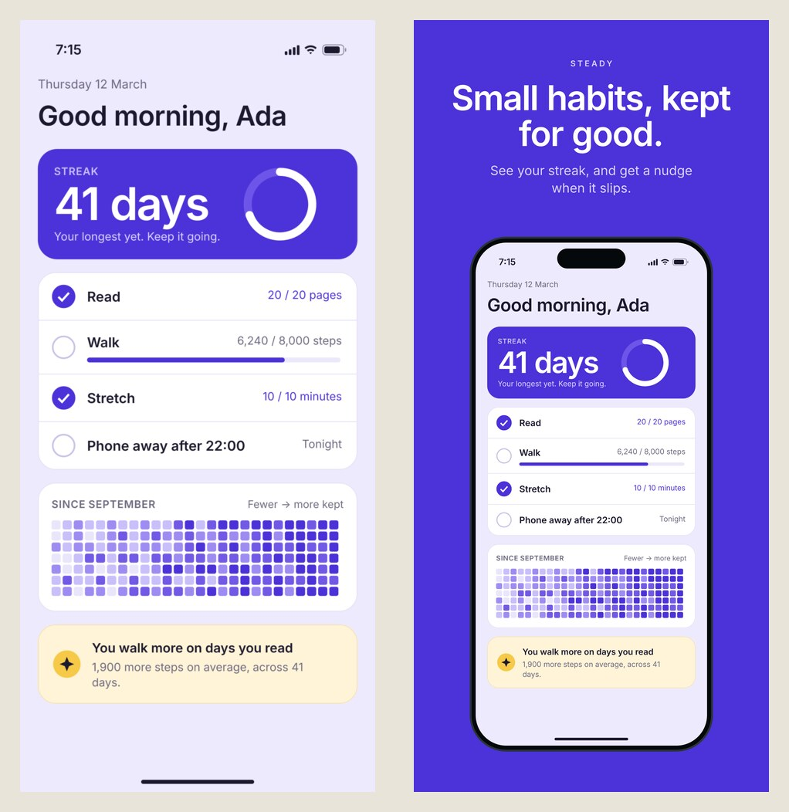
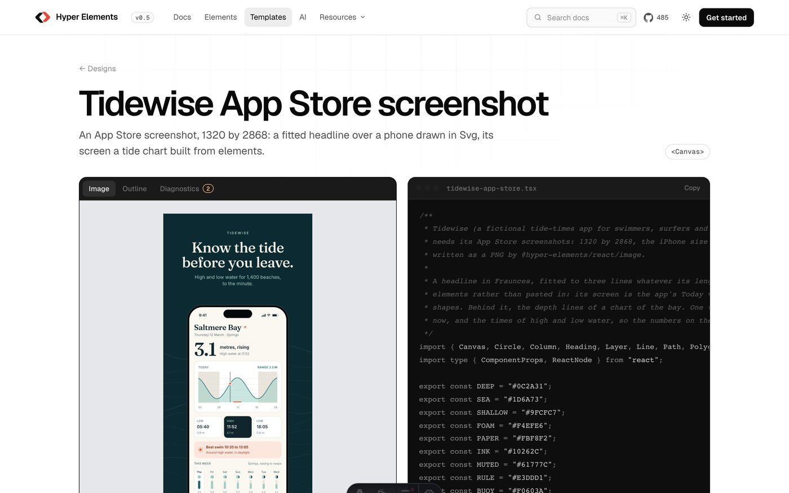

# Store screenshots

**A Hyper Elements template for App Store and Google Play screenshots: your app's raw capture, framed in a phone
drawn in Svg under a headline fitted to the space, at every size the stores ask for.**


Every app needs store screenshots, in several sizes, redone each time the UI or the copy changes. Most teams make
them by hand in Figma or pay for a screenshot tool. This template makes them in code: give it a headline, a subhead
and a simulator capture, and it draws the iPhone 6.9" and 6.5" sizes App Store Connect asks for, and Google Play's
phone size from an Android capture. Each image is checked: the capture is the right shape and size, the headline
fits, and nothing runs off the edge.

Tidewise and Steady are fictional apps; their screens are drawn with Hyper Elements too.

## Use it

```bash
git clone https://github.com/adityasarade/hyper-elements-app-store-screenshots
cd hyper-elements-app-store-screenshots
npm install
npm run render        # every design in designs/ → out/designs/*.png
```

Make your own. Capture a screen in the iPhone 16 Pro Max or 17 Pro Max simulator
(`xcrun simctl io booted screenshot capture.png`, 1320 by 2868), write a brief, and render:

```bash
cat > brief.json <<'EOF'
{ "app": "Your App", "headline": "Plan the week in a minute.", "subhead": "Every task, every person, on one calm board.",
  "colors": { "background": "#123B2C", "headline": "#FFFFFF", "subhead": "#BFE3D2" }, "pattern": "none", "headlineFont": "sans" }
EOF
npx hyper-elements design new templates/app-store-screenshot.tsx -o designs/plan.values.json \
  --values brief.json --set screenshot=@capture.png
npx hyper-elements render designs/plan.values.json --out out
# → out/designs/plan.iphone69.png, plan.iphone65.png, plan.play.png
```

For Google Play, make a second values file with the Android capture and keep only `"play"` in its `formats`
(see [`designs/01-today-android.values.json`](designs/01-today-android.values.json)).

A values file is data, so it's safe to generate from a CMS, a spreadsheet or an agent: nothing in it runs. Change
one value later with `npx hyper-elements design set designs/plan.values.json headline="…"`. The template refuses a
value it can't draw and says which field and why.

## From a capture to a store screenshot



## Your app, your colors

The three backdrops (`deep`, `foam`, `sea`) are presets. `colors` puts your own over them, `pattern` turns the
contour lines off, and `headlineFont` switches the headline from Fraunces to Inter. Steady is the same template:

```json
{ "app": "Steady", "headline": "Small habits, kept for good.", "subhead": "See your streak, and get a nudge when it slips.",
  "colors": { "background": "#4B32D9", "headline": "#FFFFFF", "subhead": "#D9D2FF" }, "pattern": "none", "headlineFont": "sans" }
```



## Every size the stores ask for


| Format | Size | Store | Phone |
|--------|------|-------|-------|
| `iphone69` | 1320 × 2868 | App Store Connect, iPhone 6.9" (the size it requires) | iPhone, Dynamic Island |
| `iphone65` | 1284 × 2778 | App Store Connect, iPhone 6.5" | iPhone, Dynamic Island |
| `play` | 1080 × 1920 | Google Play, phone | Android, punch-hole camera |

The phone sits the same distance from the bottom in every screenshot of a size, so a listing lines up side by side
whatever its headlines say. The headline is fitted to the room above the phone.


## How Hyper Elements is used

**The design**, [`src/tidewise-app-store.tsx`](src/tidewise-app-store.tsx), is a `Canvas` written as a PNG by
`renderImage()` from `@hyper-elements/react/image`.

- **The phone is drawn, not pasted.** Its body is two rounded `Column`s; its screen is a `Layer` whose first child is
  the screenshot (it fills the screen, cropped from the center) and whose second is the Dynamic Island or the
  Android camera, drawn in `Svg` over it.
- **The headline is fitted text.** `fit={{ sizes: [128, 116, 104, 96], maxLines: 3 }}` inside a fixed-height box
  draws it at the largest size that fits, measured with the real fonts. The subhead is fitted the same way.
- **The backdrop** is contour lines drawn as `Path`s, under a `Layer` with the words and the phone.
- **In the gallery version the screen is drawn in elements too**, so the file needs no images: `TodayScreen` lays
  out the app with `Row`, `Column`, `Text` and `Svg` at any size, its tide chart drawn from a tide model.
  [`scripts/screens.tsx`](scripts/screens.tsx) renders the same screens as 1320 × 2868 and 1080 × 2347 captures.

**The template**, [`templates/app-store-screenshot.tsx`](templates/app-store-screenshot.tsx), is `template()` from
`@hyper-elements/react/template`:

```tsx
formats: {
  iphone69: { width: 1320, height: 2868 },
  iphone65: { width: 1284, height: 2778 },
  play: { width: 1080, height: 1920 },
},
fields: {
  app: prop.text({ label: "App name", required: true, maxLength: 24 }),
  headline: prop.text({ label: "Headline", required: true, maxLength: 48 }),
  subhead: prop.text({ label: "Subhead", required: true, maxLength: 72 }),
  screenshot: field.image({ label: "Screenshot", required: true, accepts: ["png", "jpeg"],
    aspect: { min: 0.44, max: 0.48 }, minWidth: 1080, fit: "cover", maxCrop: 0.05 }),
  backdrop: prop.choice(["deep", "foam", "sea"], { default: "deep" }),
  colors: prop.object({ background: prop.color(), headline: prop.color(), subhead: prop.color(), lines: prop.color() }),
  pattern: prop.choice(["contours", "none"], { default: "contours" }),
  headlineFont: prop.choice(["serif", "sans"], { default: "serif" }),
},
rules: { require: { core: ["image/overflow", "image/glyph", "image/fit"] } },
```

- **Locked:** each size's layout, the phones and the fonts. **Open:** the fields above, each with guidance for
  whoever fills it (`npx hyper-elements describe templates/app-store-screenshot.tsx` shows it).
- **The capture is checked** for its type, its shape (a tall phone capture), its size (`check` reports the pixels each
  format's screen needs: 860 × 1869 for the 6.9") and how much `cover` crops it (at most 5% a side).
- **Rules over the result:** nothing past the Canvas, a font for every character, a headline and subhead that fit.
  `check` and `render` measure each image with its fonts to decide them.
- **Fonts are files beside the template** (`fonts/`, OFL), so the command line draws the images offline.
- **Provenance:** each values file records its capture's SHA-256 and where it came from (`--source`).

## Checks

```
$ npm run check
✓ src/tidewise-app-store.tsx (Canvas)
✓ templates/app-store-screenshot.tsx (Canvas)
✓ designs/01-today.values.json [iphone69] (Canvas)   … and 11 more
14 designs: 0 errors, 0 warnings, 0 skipped

$ npm run build
✓ src/tidewise-app-store.tsx (Canvas): 0 errors and warnings, 2 notes
```

The two notes say that the HTML preview of a Canvas draws fitted text at its largest size: only the image measures
it. `npx tsc --noEmit` passes.

## Add it to the gallery

Copy [`src/tidewise-app-store.tsx`](src/tidewise-app-store.tsx) to `apps/website/examples/templates/`. It has the gallery's `meta` and renders with no props.
It needs no image files: in this version the phone's screen is drawn in elements.

We tested exactly that: the file, unchanged, in a local clone of the Hyper Elements site, through the site's own
generator (`pnpm generate`) and dev server. It rendered with 2 notes, both `info` (the HTML preview draws fitted text at its largest size; the PNG measures it), and appears on `/templates/tidewise-app-store` beside the
official designs:



## Files

| Path | What it is |
|------|------------|
| `src/tidewise-app-store.tsx` | The design: `Screenshot`, `Phone`, `Depths`, `TodayScreen`, and the gallery's default export |
| `templates/app-store-screenshot.tsx` | The template: formats, fields, rules, example |
| `designs/*.values.json` | Tidewise's listing and Steady's screenshot, as values (iPhone, and `-android` for Google Play) |
| `designs/screens/` | The apps' raw captures and where they came from |
| `app/`, `scripts/screens.tsx` | The two apps' screens in elements, and the script that draws them as captures |
| `fonts/` | Fraunces and Inter, with their licenses |
| `scripts/build.tsx` | Renders `src/` as the gallery does |

## License

MIT. Fraunces and Inter are from Google Fonts under the SIL Open Font License (`fonts/OFL-*.txt`).
Built with [Hyper Elements](https://github.com/hyper-elements/hyper-elements) for Unlayer's Hyper Elements
Template Challenge.
