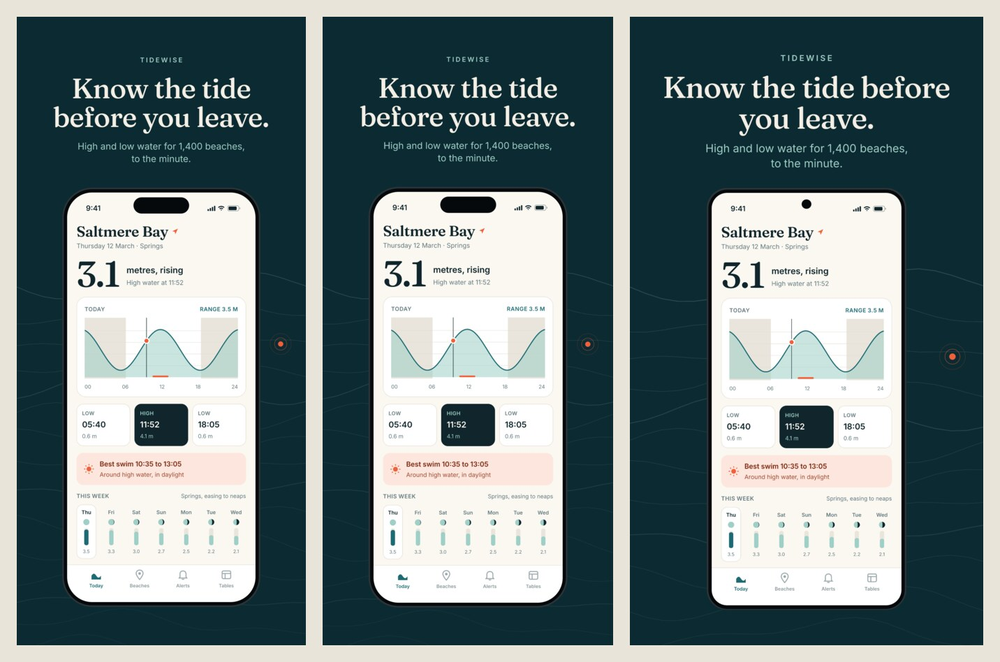
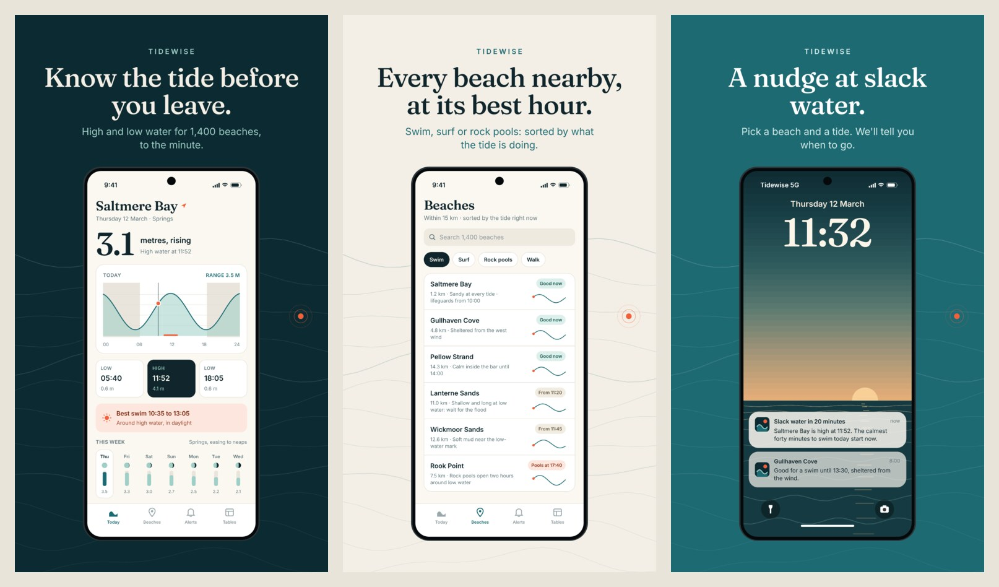

# Tidewise store screenshots

**A Hyper Elements template for App Store and Google Play screenshots: your app's raw capture, framed in a phone
drawn in Svg under a headline fitted to the space, at every size the stores ask for.**


Every app needs store screenshots, in several sizes, redone each time the UI or the copy changes. Most teams make
them by hand in Figma or pay for a screenshot tool. This repository makes them in code: give the template a headline,
a subhead and a simulator capture, and it draws the iPhone 6.9" and 6.5" sizes App Store Connect asks for and
Google Play's phone size, each checked so nothing is cut off and the headline fits.

Tidewise is a fictional tide-times app. Its screens, the tide, the beaches and the brand are invented.

## Use it

```bash
git clone https://github.com/adityasarade/hyper-elements-app-store-screenshots
cd hyper-elements-app-store-screenshots
npm install
npm run render        # every design in designs/, in every size, to out/designs/*.png
```

Make one from your own app. Take a full-screen capture in the iPhone 16 Pro Max or 17 Pro Max simulator
(`xcrun simctl io booted screenshot capture.png`, 1320 by 2868), then:

```bash
echo '{ "app": "Your App", "headline": "Plan the week in a minute.", "subhead": "Every task, every person, on one calm board.", "backdrop": "foam" }' > brief.json

npx hyper-elements design new templates/app-store-screenshot.tsx -o designs/plan.values.json \
  --values brief.json --set screenshot=@capture.png
npx hyper-elements render designs/plan.values.json --out out
# → out/designs/plan.iphone69.png, plan.iphone65.png, plan.play.png
```

A values file is data: nothing in it runs, so it's safe to generate from a CMS, a spreadsheet or an agent. Change one
value later with `npx hyper-elements design set designs/plan.values.json headline="…"`. The template refuses a value
it can't draw, and says which field and why.

Or use the design directly in React code:

```tsx
import { Image } from "@hyper-elements/react";
import { renderImage } from "@hyper-elements/react/image";
import { Screenshot } from "./src/tidewise-app-store";

const { image } = await renderImage(
  Screenshot({
    app: "Your App",
    headline: "Plan the week in a minute.",
    subhead: "Every task, every person, on one calm board.",
    backdrop: "foam",
    size: "iphone69",
    screen: <Image src={{ src: "https://cdn.example.com/capture.png", width: 1320, height: 2868 }} alt="" />,
  }),
  { fonts, images: { "https://cdn.example.com/capture.png": captureBytes } },
);
```

## From a capture to a store screenshot


## One set of values, three sizes



| Format | Size | Store | Phone |
|--------|------|-------|-------|
| `iphone69` | 1320 × 2868 | App Store Connect, iPhone 6.9" (the size it requires) | iPhone, Dynamic Island |
| `iphone65` | 1284 × 2778 | App Store Connect, iPhone 6.5" | iPhone, Dynamic Island |
| `play` | 1080 × 1920 | Google Play, phone | Android, punch-hole camera |



## How Hyper Elements is used

**The design** is [`src/tidewise-app-store.tsx`](src/tidewise-app-store.tsx), a `Canvas` written as a PNG by
`renderImage()` from `@hyper-elements/react/image`.

- **The phone is drawn, not pasted.** Its body is two `Column`s with rounded corners (graphite, then glass). Its
  screen is a `Layer`: the screenshot is the Layer's first child, so it fills the screen and is cropped from the
  center, and the Dynamic Island (or Android's camera) is an `Svg` laid over it.
- **The headline is fitted.** `fit={{ sizes: [128, 116, 104, 96], maxLines: 3 }}` draws it at the largest size that
  keeps it to three lines, measured with the real fonts. The subhead is fitted the same way. The whole block is
  centered, so a longer headline takes from the margins above and below alike and never pushes the phone off.
- **The backdrop is a chart of the bay**: depth contours drawn as `Path`s from two sine waves, and a buoy in
  `Circle`s. Three backdrops (`deep`, `foam`, `sea`) alternate along a listing.
- **In the gallery version the screen is built in elements too.** `TodayScreen` lays out the app's Today view with
  `Row`, `Column`, `Text` and `Svg` at any size (`k` pixels to the iPhone's point). One tide model gives the curve,
  the height now (3.1 m, rising), the times of high and low water, and the swim window, so every number on the
  screen agrees with every other. The moon phases in the week strip wane from full at springs toward the last
  quarter at neaps, as they should.
- **The app's screens are drawn with Hyper Elements as well.** [`scripts/screens.tsx`](scripts/screens.tsx) renders
  [`app/screens.tsx`](app/screens.tsx) (Today, Beaches, and a lock-screen alert at dusk) at 1320 by 2868, the
  stand-ins for simulator captures in `designs/screens/`.

**The template** is [`templates/app-store-screenshot.tsx`](templates/app-store-screenshot.tsx), made with
`template()` from `@hyper-elements/react/template`:

```tsx
formats: {
  iphone69: { width: 1320, height: 2868 },
  iphone65: { width: 1284, height: 2778 },
  play: { width: 1080, height: 1920 },
},
fields: {
  app: prop.text({ label: "App name", required: true, maxLength: 24 }),
  headline: prop.text({ label: "Headline", required: true, maxLength: 48, guidance: "Five to eight words, ending with a full stop." }),
  subhead: prop.text({ label: "Subhead", required: true, maxLength: 72 }),
  screenshot: field.image({ label: "Screenshot", required: true, accepts: ["png", "jpeg"],
    aspect: { min: 0.44, max: 0.48 }, minWidth: 1080, fit: "cover", maxCrop: 0.05 }),
  backdrop: prop.choice(["deep", "foam", "sea"], { label: "Backdrop", default: "deep" }),
},
rules: { require: { core: ["image/overflow", "image/glyph", "image/fit"] } },
```

- **Locked:** the layout of each size, the phone, the backdrops, the colors and the fonts. **Open:** the five fields.
- **The screenshot is checked** for its type, its shape (a tall phone capture, not a landscape image), its size
  (`check` reports the pixels each format's screen needs: 860 × 1869 for the 6.9") and how much `cover` crops it
  (at most 5% a side).
- **Rules over the result:** nothing past the Canvas, a font for every character, and a headline and subhead that
  fit. These are decided when the image is measured, so `check` and `render` both measure it with the fonts.
- **Fonts are files beside the template** (`fonts/`, OFL), so the command line draws the images offline.
- **Provenance:** each values file records its screenshot's SHA-256 and where it came from (`--source`), so a
  generated or replaced capture is visible in review.

`npx hyper-elements describe templates/app-store-screenshot.tsx` shows what someone filling it sees.

## Checks

```
$ npm run check
✓ src/tidewise-app-store.tsx (Canvas)
✓ templates/app-store-screenshot.tsx (Canvas)
✓ designs/01-today.values.json [iphone69] (Canvas)   … and 8 more
11 designs: 0 errors, 0 warnings, 0 skipped

$ npm run build
✓ src/tidewise-app-store.tsx (Canvas): 0 errors and warnings, 2 notes
```

The two notes say that the HTML preview of a Canvas draws fitted text at its largest size: only the image measures
it.

`npm run build` renders the gallery design the way the Hyper Elements gallery does (HTML, plain text, outline,
diagnostics and the PNG) into `out/`. `npx tsc --noEmit` passes.

## Add it to the gallery

Copy [`src/tidewise-app-store.tsx`](src/tidewise-app-store.tsx) to `apps/website/examples/templates/`. It has the
gallery's `meta`, renders with no props, imports only `@hyper-elements/react`, and needs no images: its screen is
drawn in elements. Its fonts are Google Fonts, which the gallery's generator already loads.

## Files

| Path | What it is |
|------|------------|
| `src/tidewise-app-store.tsx` | The design: `Screenshot`, `Phone`, `Depths`, `TodayScreen`, and the gallery's default export |
| `templates/app-store-screenshot.tsx` | The template: formats, fields, rules, example |
| `designs/*.values.json` | The three screenshots of the listing, as values |
| `designs/screens/` | The app's raw screens, 1320 × 2868, and where they came from |
| `app/screens.tsx`, `scripts/screens.tsx` | The app's screens in elements, and the script that draws them |
| `fonts/` | Fraunces and Inter, with their licenses |
| `scripts/build.tsx` | Renders `src/` as the gallery does |

## License

MIT. Fraunces and Inter are from Google Fonts under the SIL Open Font License (`fonts/OFL-*.txt`).
Built with [Hyper Elements](https://github.com/hyper-elements/hyper-elements) for Unlayer's Hyper Elements
Template Challenge.
